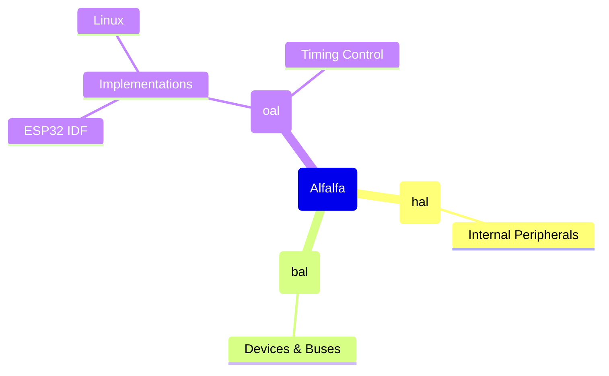

# alfalfa

[](https://pypi.org/project/alfalfa)
[](https://pypi.org/project/alfalfa)


This is a library for embedded systems (and maybe more).

-----

## Table of Contents

- [Installation](#installation)
- [License](#license)

## Installation

```console
pip install alfalfa
```

## Tree Structure





## License

`alfalfa` is distributed under the terms of the [MIT](https://spdx.org/licenses/MIT.html) license.
